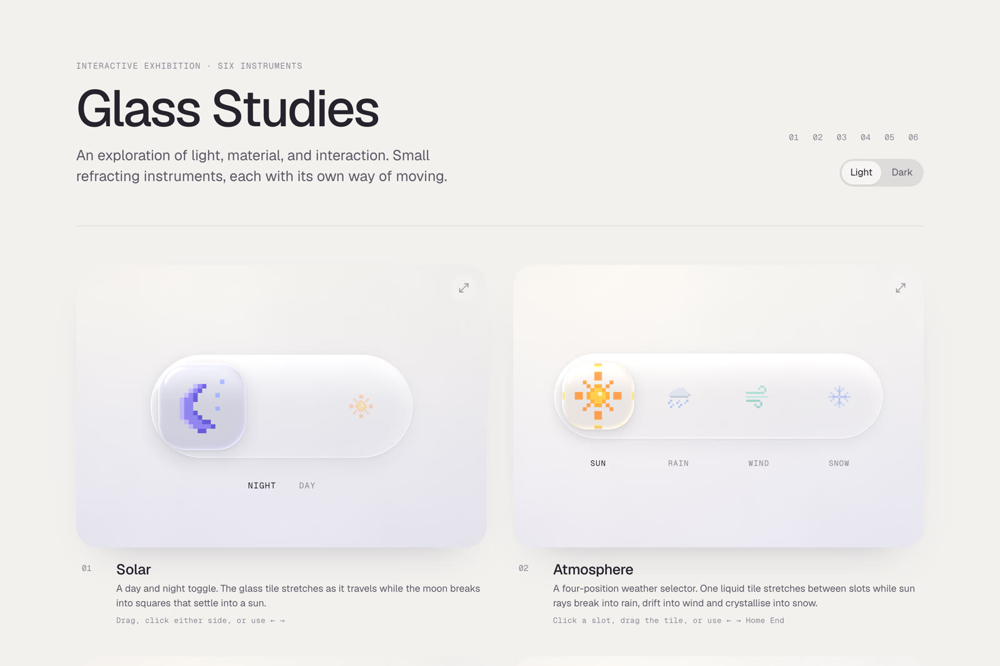
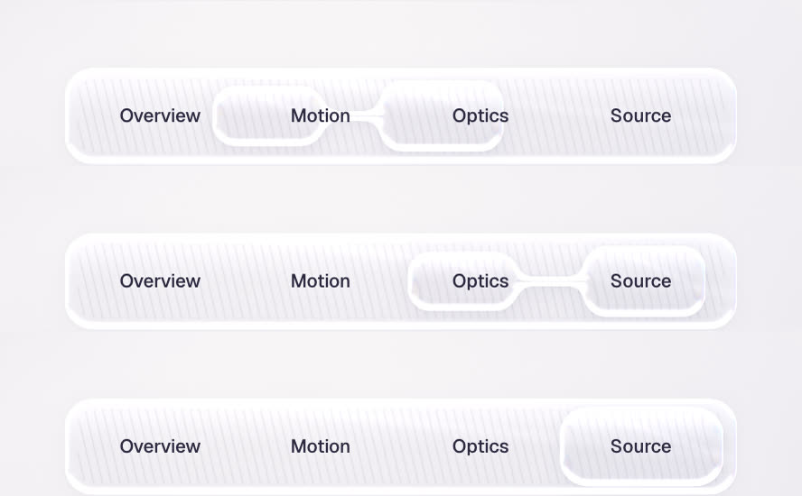
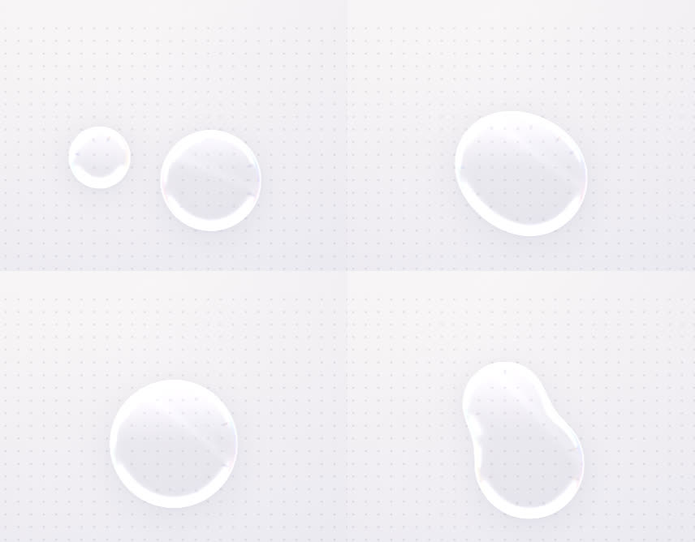
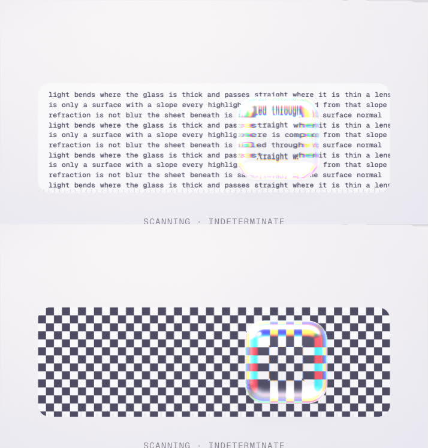
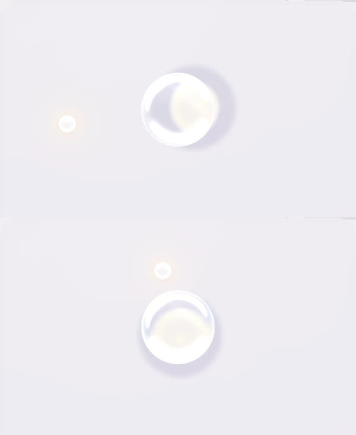
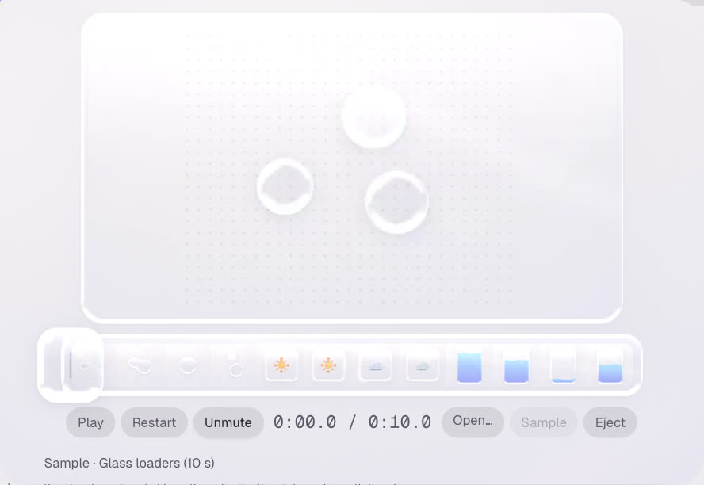
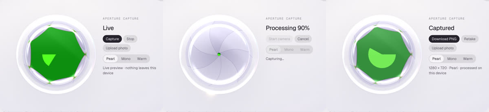
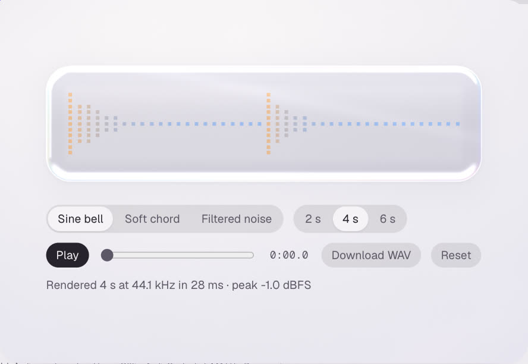
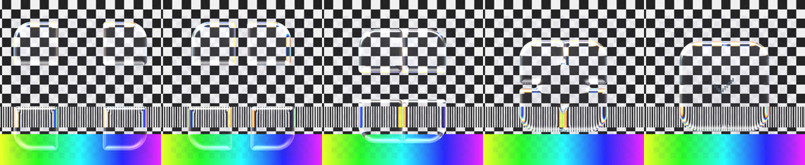

# Glass Studies

*An exploration of light, material, and interaction.*

> **V2, "Pearl Optics"** (tag `v2.0.0`, now on `main`) is a visual and material refinement toward a supplied art-direction sheet: pearl-neutral glass, thick milky rims, studio specular streaks, restrained spectral fringes, coloured halos and LED dot-matrix pixel art. V1 is preserved at tag **`v1-original`**. See [docs/V2_VISUAL_COMPARISON.md](docs/V2_VISUAL_COMPARISON.md).
>
> **V2.1 material polish** (now on `main`): lighter, clearer pearl glass on light studios with dark pearl-grey ink, rounded-square trays for Atmosphere and Thermal, and Halo's orbit ring removed. Before/after pairs are in [docs/media/v2.1](docs/media/v2.1).
>
> **V3, Instruments & Loaders** (branch `v3/glass-instruments`, built on `v3/new-studies`): fifteen new studies in three collections (**Controls**, **Loaders**, **Optics & Materials**) next to the original six. Several do real work: a video scrubber over real decoded frames, a camera capture with a local image pipeline, an in-browser audio render with WAV export. See [V3 collections](#v3-collections).
>
> | V1 | V2 |
> | --- | --- |
> |  |  |
>
> Run both side by side: V2 with `npm run dev` (port **5373**), and V1 from a worktree of the tag:
> ```bash
> git worktree add ../glass-studies-v1 v1-original && cd ../glass-studies-v1 && npm install && npx vite --port 5372
> ```

Glass Studies is an interactive exhibition of liquid-glass studies in four collections: the original six **Weather Instruments**, six **Controls**, eight **Loaders** and three **Optics & Materials** studies. Every control is live. The glass refracts what lies beneath it on the GPU, thumbs stretch and settle on real springs, a luminous highlight races around rims as they move, and the pixel-art icons rebuild themselves square by square.


| Refraction over the optics test pattern | Midnight backdrop |
| --- | --- |
|  |  |

Solar transition, sampled every 33 ms with a deterministic clock (`?manual`):


## Run it

```bash
npm install
npm run dev        # http://localhost:5373 (V2)
npm run build && npm run preview   # production build on http://localhost:4373
```

Useful URL flags:

| Flag | Effect |
| --- | --- |
| `#/study/<id>` | Open a study in the focused view: `solar` `atmosphere` `halo` `thermal` `modes` `forecast` · `iris` `droplet` `drift` `tabs` `beads` `scrubber` · `loader-merge` `loader-tide` `loader-morph` `loader-magnet` `capture` `audio` `loader-orbit` `loader-crystal` · `lens-scan` `caustic` `stitch` |
| `?env=optics` | Start the focused view on a backdrop (`pearl`, `midnight`, `atmosphere`, `optics`) |
| `?fallback` | Force the Canvas2D frosted fallback (no refraction) |
| `?inspect` | Show the material inspector in production builds (it is always on in dev) |
| `?manual` | Freeze time. Frames advance only via `window.__glass.advance(ms)`, for reproducible captures |

## The original six studies

| # | Study | Input | What moves |
| --- | --- | --- | --- |
| 01 | **Solar** (day/night switch) | drag, click either side, ← → Space Home End | Thumb on a spring with stretch, lean and end-stop compression. The moon→sun morph is *scrubbed by the thumb*, edge light, warm/cool ambient light |
| 02 | **Atmosphere** (4-way weather radiogroup) | click/tap, drag tile, press-and-slide on track, arrows Home End | A liquid tile that stretches strongly, icon particle morphs, a short pass of weather through the air |
| 03 | **Halo** (brightness slider, 0–100 %, default 72) | drag around the dial, wheel while focused, arrows PageUp/Down Home End | Arc, glass bead, sun rays, dial warmth, surface exposure, perimeter glow following the handle |
| 04 | **Thermal** (vertical slider, 10–35 °C demo range) | drag the thumb 1:1, press the track, ↑ ↓ in 0.5° steps, PageUp/Down Home End | Warm/cool capsule fill, ticks seen through glass, card illustration (frost / cloud / sun), air colour |
| 05 | **Modes** (4-way radiogroup) | as Atmosphere | Heavier, leaning tile. A leaf bends, a bolt charges, stars twinkle, a bud opens (two-step morph) |
| 06 | **Forecast** (compound card) | day radiogroup, *Detailed view* switch | Three glass layers. The card height is a spring, nested glass follows it each frame. **Sample data, not live** |

## V3 collections

Built on the same renderer, springs, edge light and pixel system as the original six. Every focused view adds the study's full controls; looping studies have **pause / play, restart and 0.5× / 1× / 1.5×** (cards have a pause button too), and determinate ones accept a fraction from a slider that is labelled **"Simulated progress"**: a loop never shows a number.

### Controls

| | Study | What it really does |
| --- | --- | --- |
| C1 | **Iris** | Aperture f/1.8–f/16. Turn the ring anywhere (unwrapped angles, `RotaryTracker`), click a printed stop, wheel, ← → Home End. Blades are one disc with the aperture polygon cut out, radius ∝ 1/N, so the opening is strictly monotonic; the readout shows (1.8/N)² as an illustration, not an exposure meter |
| C2 | **Droplet** | Press and hold for 0.9 s **of elapsed time** (monotonic clock, not frames) to toggle Quiet mode; releasing early, sliding off, Escape, lost capture or blur cancel. The drop conserves area as it flattens |
| C3 | **Drift** | Wind direction and strength in [−1, 1]² through one transform. The orb follows the hand exactly; the glass stretch lags on a follower spring. Release holds or springs back to zero (persisted). Shift for fine steps, Home or double-click centres |
| C4 | **Liquid Tabs** | ARIA tabs (Overview, Motion, Optics, Source) with real panels. The selection is one fused glass membrane measured from the tab buttons: a leading lobe, a trailing lobe and an area-preserving neck. Interruptible; automatic activation |
| C5 | **Beads** | Focus window on 24 h in 15-minute steps, ≥ 15 minutes (clamp, never swap). Drag either bead, drag the window between them as a whole, tap the track; fused beads are told apart by the first movement |
| C6 | **Glass Scrubber** | A real video timeline. Thumbnails and hover previews are frames decoded from the video; a lens refracts them. A seek queue coalesces scrubs; play / pause / mute / restart / ±5 s; open your own file (object URL, never uploaded); clear errors for unsupported files |

### Loaders

| | Loader | What it really does |
| --- | --- | --- |
| L1 | **Merge** | Three droplets as one smooth-union surface; radii grow with √mass, so merging conserves area. Determinate 100% = one bead with a check |
| L2 | **Tide Fill** | Determinate level is true **volume** through the rounded caps; a 24-column damped surface keeps its mean and is bounded; completion bubble and check |
| L3 | **Pixel Assembly** | Sun → cloud → leaf → moon with particle identity; determinate mode assembles a chosen icon whose 100% frame is the authored bitmap exactly |
| L4 | **Magnetic Beads** | Fixed-step physics with softened, capped forces and positional collisions; hold a magnet, flip polarity, set strength, settle into a check |
| L5 | **Aperture Capture** | Camera only on Start (permission), live preview in the iris, Capture closes the shutter over the real frame, a local pixel pipeline (Pearl / Mono / Warm) drives a **measured** progress ring, PNG download. Upload fallback; denied / missing camera states; streams always released |
| L6 | **Audio Render** | Three original presets rendered by an `OfflineAudioContext` (progress measured with `suspend()`), normalised to −1 dBFS, 16-bit PCM WAV; the waveform is the real samples' peak and RMS; play, seek, download |
| L7 | **Orbit** · L8 **Crystallize** | The V3 looping loaders, now with the shared transport |

### Optics & Materials

| | Study | What it really does |
| --- | --- | --- |
| M1 | **Lens Scan** | A thick lens refracts a sheet texture (microtype, fine lines, checker, image); only what it covers moves. Ping-pong loop, determinate placement, completion |
| M2 | **Caustic** | A CPU photon map traced through the lens's own profile and IOR (1.52) onto the plane; drag the light (kept off the glass), sphere or capsule, muted or high contrast |
| M3 | **Glass Stitch** | Four exact quadrant fragments with per-corner radii meet in order; bridges form at contact and a bonding core makes the finished panel one continuous lens with no seams |

| Liquid Tabs mid-travel | Merge | Lens Scan over the checker | Caustic |
| --- | --- | --- | --- |
|  |  |  |  |
| **Glass Scrubber** | **Aperture Capture** | **Audio Render** | **Glass Stitch 0 → 100%** |
|  |  |  |  |

Media and data: the Scrubber's sample clip is rendered from this project's own loaders (`scripts/make-media.mjs`); test clips encode their time as a bar width so tests can read the decoded frame. The camera, uploads and audio never leave the browser.

## How it works (short version)

- **Rendering:** `src/glass/` is a custom WebGL2 renderer. Each stage is one canvas. A frame is a chain of full-screen passes: the studio environment, then each glass layer refracting the result of the pass before it. Glass shapes are analytic rounded rectangles, so geometry, refraction, highlights and edge light are computed from the same uniforms and can never detach. See [docs/ARCHITECTURE.md](docs/ARCHITECTURE.md).
- **Optics:** a convex-squircle height profile gives a surface normal, which is refracted with Snell's law (IOR 1.52). The bent ray travels through the slab depth to give the displacement. Added on top: chromatic dispersion, rim-weighted frost, fresnel reflection of the surroundings, a lit and an unlit rim, a crisp hairline, faint thin-film iridescence and caustic light on the far rim.
- **Motion:** semi-implicit spring integration with fixed sub-steps (`src/motion/spring.ts`). Velocity carries over when a target changes. Squash and stretch is a second spring chasing |velocity|, so the single arrival compression comes from the physics.
- **Edge light:** a perimeter coordinate for rounded rects, exact arclength and identical in TypeScript and GLSL. The head advances by the distance the glass actually travels, with a soft trail and a wrap-safe seam.
- **Pixel morphs:** 12×12 original pixel grids. Morphing uses seeded greedy minimum-distance matching, exits fly outward, entries split from the nearest square, and timing is staggered with bowed paths. Morphs can be time-driven (they continue from the rendered positions when interrupted) or scrubbed by a control value.
- **Fused glass (V3):** a layer can be one optical surface made of several shapes (polynomial smooth-min of their distance fields). Refraction normals come from the fused field's gradient and perimeter-locked highlights use one shared frame, so necks and bridges bend light like the bodies they join. Shapes may also have a radius per corner.
- **GPU contexts (V3):** a stage holds a WebGL2 context only while it is within 600 px of the viewport, and releases it while the focused view covers the gallery, so 23 studies never exceed the browser's context limit.
- **Fallback:** Canvas2D frosted glass with rim and edge light but no refraction, labelled on screen. It is used without WebGL2, after context loss, or with `?fallback`.

## Browser support

| Browser | Result (verified with Playwright 1.64 on macOS) |
| --- | --- |
| Chromium / Chrome / Edge | Full WebGL2 refraction. All E2E and interaction tests pass |
| WebKit (Safari engine) | WebGL2 refraction. Smoke tests pass (render, theme, focus view, fallback) |
| Firefox | WebGL2 refraction. Smoke tests pass |
| No WebGL2 | Frosted Canvas2D fallback, fully functional and labelled |

Real iOS and Android hardware has not been tested. Mobile behaviour was verified with Pixel 7 emulation (touch tap, touch drag, layout).

## Tests

```bash
npm run typecheck        # tsc -b
npm run lint             # oxlint
npm test                 # Vitest: 136 unit/component tests
npx vitest run --coverage
npm run test:e2e         # Playwright against the production build (Chromium, mobile, WebKit, Firefox)
node scripts/perf.mjs    # frame-time probe with the six original studies animating (needs `npm run preview`); --all puts everything on screen
node scripts/perf-loaders.mjs            # frame times with the loaders on screen, then the idle check after scrolling away
node scripts/capture-v3.mjs --env=pearl  # real-input captures of the V3 instruments
node scripts/capture-loaders.mjs         # frames across one loop of each loader
node scripts/shoot.mjs '/?manual#/study/solar' name 1200 820 --frames=24 --interval=33   # frame captures
node scripts/frame.mjs --id=stitch --steps='[{"adv":500,"shot":"a"}]'   # scripted focused-view frames (?manual)
node scripts/regress.mjs --only=solar,halo   # pixel regression against a baseline build (default :5375)
node scripts/make-media.mjs                # regenerate the Scrubber sample clip and test fixtures
```

Results at the time of writing are in [docs/QA.md](docs/QA.md).

## Documentation

- [docs/SOURCE_AUDIT.md](docs/SOURCE_AUDIT.md): the four reference repos, licenses, and what was (and was not) reused
- [docs/ARCHITECTURE.md](docs/ARCHITECTURE.md): render pipeline, module boundaries, lifecycle
- [docs/DESIGN_SYSTEM.md](docs/DESIGN_SYSTEM.md): tokens, materials, spring presets and why
- [docs/QA.md](docs/QA.md): test matrix, measurements, known limitations
- [docs/CASE_STUDY.md](docs/CASE_STUDY.md): the design and engineering story
- [docs/V2_VISUAL_COMPARISON.md](docs/V2_VISUAL_COMPARISON.md): V2 gap analysis, comparison rounds, remaining differences
- [docs/FUTURE_STUDIES.md](docs/FUTURE_STUDIES.md): V3 candidates
- [PROGRESS.md](PROGRESS.md): milestone log

## Known limitations

- Refraction covers content the stage owns: the procedural environment and the 2D content layers (pixel art, ticks, arcs). It does **not** refract arbitrary page DOM. That is a deliberate trade for live, per-frame refraction of moving glass (see the audit).
- DOM text (readouts, labels) sits above the glass and is not refracted.
- Each stage near the viewport holds one WebGL2 context; far-off stages and the gallery behind the focused view release theirs.
- The Caustic is a CPU photon map with a stated approximation (two refracting surfaces, thin-lens travel, no reflections), recomputed when the light or lens changes.
- Headless test browsers have no audio device: E2E uses Chrome's fake audio sink (`--disable-audio-output`) for playback timing, and a fake camera for capture.
- The Forecast data is fixed sample data, and the Thermal value is a demo set point, not a measurement.

## Credits and license

MIT © 2026 Maria Showalter. No third-party source code is included. Optical ideas are credited in [docs/SOURCE_AUDIT.md](docs/SOURCE_AUDIT.md) (archisvaze/liquid-glass, nordify/css-liquid-glass and naughtyduk/liquidGL, all MIT; wiiiimm/glass-gl, AGPL, was used as research only). Fonts: Geist and Geist Mono (SIL OFL 1.1). All pixel artwork is original.
