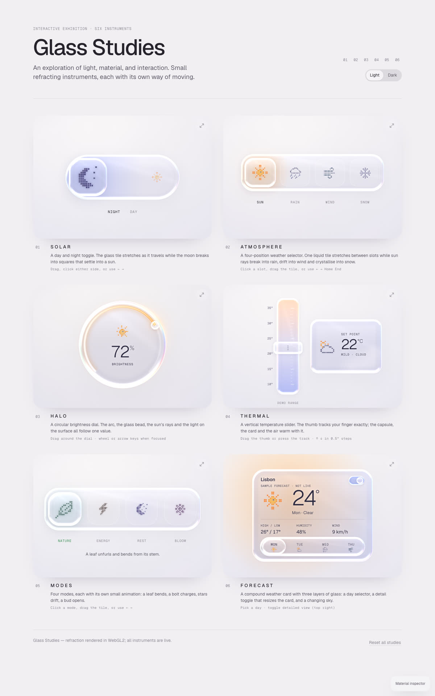
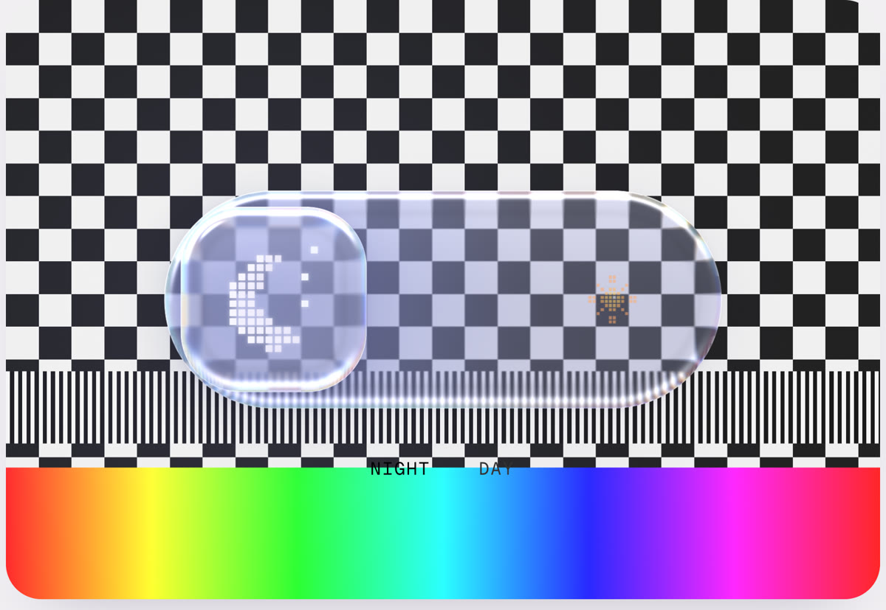
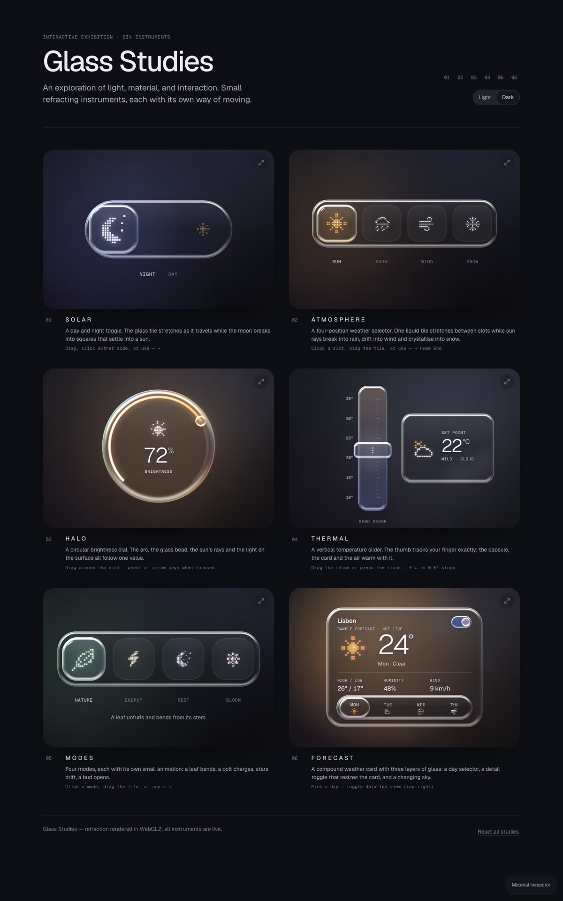

# Glass Studies

*An exploration of light, material, and interaction.*

> **V2, "Pearl Optics"** (tag `v2.0.0`, now on `main`) is a visual and material refinement toward a supplied art-direction sheet: pearl-neutral glass, thick milky rims, studio specular streaks, restrained spectral fringes, coloured halos and LED dot-matrix pixel art. V1 is preserved at tag **`v1-original`**. See [docs/V2_VISUAL_COMPARISON.md](docs/V2_VISUAL_COMPARISON.md).
>
> **V2.1 material polish** (branch `v2.1/material-polish`): lighter, clearer pearl glass on light studios with dark pearl-grey ink, rounded-square trays for Atmosphere and Thermal, and Halo's orbit ring removed. Before/after pairs are in [docs/media/v2.1](docs/media/v2.1).
>
> | V1 | V2 |
> | --- | --- |
> |  |  |
>
> Run both side by side: V2 with `npm run dev` (port **5373**), and V1 from a worktree of the tag:
> ```bash
> git worktree add ../glass-studies-v1 v1-original && cd ../glass-studies-v1 && npm install && npx vite --port 5372
> ```

Glass Studies is an interactive exhibition of six small liquid-glass instruments: a day/night toggle, a weather selector, a brightness dial, a temperature slider, a mode selector and a compound weather card. Every control is live. The glass refracts what lies beneath it on the GPU, thumbs stretch and settle on real springs, a luminous highlight races around rims as they move, and the pixel-art icons rebuild themselves square by square.



| Refraction over the optics test pattern | Midnight backdrop |
| --- | --- |
|  |  |

Solar transition, sampled every 33 ms with a deterministic clock (`?manual`):


## Run it

```bash
npm install
npm run dev        # http://localhost:5373 (V2)
npm run build && npm run preview   # production build on http://localhost:4373
```

Useful URL flags:

| Flag | Effect |
| --- | --- |
| `#/study/<id>` | Open a study in the focused view (`solar`, `atmosphere`, `halo`, `thermal`, `modes`, `forecast`) |
| `?env=optics` | Start the focused view on a backdrop (`pearl`, `midnight`, `atmosphere`, `optics`) |
| `?fallback` | Force the Canvas2D frosted fallback (no refraction) |
| `?inspect` | Show the material inspector in production builds (it is always on in dev) |
| `?manual` | Freeze time. Frames advance only via `window.__glass.advance(ms)`, for reproducible captures |

## The six studies

| # | Study | Input | What moves |
| --- | --- | --- | --- |
| 01 | **Solar** (day/night switch) | drag, click either side, ← → Space Home End | Thumb on a spring with stretch, lean and end-stop compression. The moon→sun morph is *scrubbed by the thumb*, edge light, warm/cool ambient light |
| 02 | **Atmosphere** (4-way weather radiogroup) | click/tap, drag tile, press-and-slide on track, arrows Home End | A liquid tile that stretches strongly, icon particle morphs, a short pass of weather through the air |
| 03 | **Halo** (brightness slider, 0–100 %, default 72) | drag around the dial, wheel while focused, arrows PageUp/Down Home End | Arc, glass bead, sun rays, dial warmth, surface exposure, perimeter glow following the handle |
| 04 | **Thermal** (vertical slider, 10–35 °C demo range) | drag the thumb 1:1, press the track, ↑ ↓ in 0.5° steps, PageUp/Down Home End | Warm/cool capsule fill, ticks seen through glass, card illustration (frost / cloud / sun), air colour |
| 05 | **Modes** (4-way radiogroup) | as Atmosphere | Heavier, leaning tile. A leaf bends, a bolt charges, stars twinkle, a bud opens (two-step morph) |
| 06 | **Forecast** (compound card) | day radiogroup, *Detailed view* switch | Three glass layers. The card height is a spring, nested glass follows it each frame. **Sample data, not live** |

## How it works (short version)

- **Rendering:** `src/glass/` is a custom WebGL2 renderer. Each stage is one canvas. A frame is a chain of full-screen passes: the studio environment, then each glass layer refracting the result of the pass before it. Glass shapes are analytic rounded rectangles, so geometry, refraction, highlights and edge light are computed from the same uniforms and can never detach. See [docs/ARCHITECTURE.md](docs/ARCHITECTURE.md).
- **Optics:** a convex-squircle height profile gives a surface normal, which is refracted with Snell's law (IOR 1.52). The bent ray travels through the slab depth to give the displacement. Added on top: chromatic dispersion, rim-weighted frost, fresnel reflection of the surroundings, a lit and an unlit rim, a crisp hairline, faint thin-film iridescence and caustic light on the far rim.
- **Motion:** semi-implicit spring integration with fixed sub-steps (`src/motion/spring.ts`). Velocity carries over when a target changes. Squash and stretch is a second spring chasing |velocity|, so the single arrival compression comes from the physics.
- **Edge light:** a perimeter coordinate for rounded rects, exact arclength and identical in TypeScript and GLSL. The head advances by the distance the glass actually travels, with a soft trail and a wrap-safe seam.
- **Pixel morphs:** 12×12 original pixel grids. Morphing uses seeded greedy minimum-distance matching, exits fly outward, entries split from the nearest square, and timing is staggered with bowed paths. Morphs can be time-driven (they continue from the rendered positions when interrupted) or scrubbed by a control value.
- **Fallback:** Canvas2D frosted glass with rim and edge light but no refraction, labelled on screen. It is used without WebGL2, after context loss, or with `?fallback`.

## Browser support

| Browser | Result (verified with Playwright 1.64 on macOS) |
| --- | --- |
| Chromium / Chrome / Edge | Full WebGL2 refraction. All E2E and interaction tests pass |
| WebKit (Safari engine) | WebGL2 refraction. Smoke tests pass (render, theme, focus view, fallback) |
| Firefox | WebGL2 refraction. Smoke tests pass |
| No WebGL2 | Frosted Canvas2D fallback, fully functional and labelled |

Real iOS and Android hardware has not been tested. Mobile behaviour was verified with Pixel 7 emulation (touch tap, touch drag, layout).

## Tests

```bash
npm run typecheck        # tsc -b
npm run lint             # oxlint
npm test                 # Vitest: 62 unit/component tests
npx vitest run --coverage
npm run test:e2e         # Playwright against the production build (Chromium, mobile, WebKit, Firefox)
node scripts/perf.mjs    # frame-time probe with all six studies animating (needs `npm run preview`)
node scripts/shoot.mjs '/?manual#/study/solar' name 1200 820 --frames=24 --interval=33   # frame captures
```

Results at the time of writing are in [docs/QA.md](docs/QA.md).

## Documentation

- [docs/SOURCE_AUDIT.md](docs/SOURCE_AUDIT.md): the four reference repos, licenses, and what was (and was not) reused
- [docs/ARCHITECTURE.md](docs/ARCHITECTURE.md): render pipeline, module boundaries, lifecycle
- [docs/DESIGN_SYSTEM.md](docs/DESIGN_SYSTEM.md): tokens, materials, spring presets and why
- [docs/QA.md](docs/QA.md): test matrix, measurements, known limitations
- [docs/CASE_STUDY.md](docs/CASE_STUDY.md): the design and engineering story
- [docs/V2_VISUAL_COMPARISON.md](docs/V2_VISUAL_COMPARISON.md): V2 gap analysis, comparison rounds, remaining differences
- [docs/FUTURE_STUDIES.md](docs/FUTURE_STUDIES.md): V3 candidates
- [PROGRESS.md](PROGRESS.md): milestone log

## Known limitations

- Refraction covers content the stage owns: the procedural environment and the 2D content layers (pixel art, ticks, arcs). It does **not** refract arbitrary page DOM. That is a deliberate trade for live, per-frame refraction of moving glass (see the audit).
- DOM text (readouts, labels) sits above the glass and is not refracted.
- Each stage holds one WebGL2 context (six in the gallery, plus one in the focused view).
- The Forecast data is fixed sample data, and the Thermal value is a demo set point, not a measurement.

## Credits and license

MIT © 2026 Maria Showalter. No third-party source code is included. Optical ideas are credited in [docs/SOURCE_AUDIT.md](docs/SOURCE_AUDIT.md) (archisvaze/liquid-glass, nordify/css-liquid-glass and naughtyduk/liquidGL, all MIT; wiiiimm/glass-gl, AGPL, was used as research only). Fonts: Geist and Geist Mono (SIL OFL 1.1). All pixel artwork is original.
